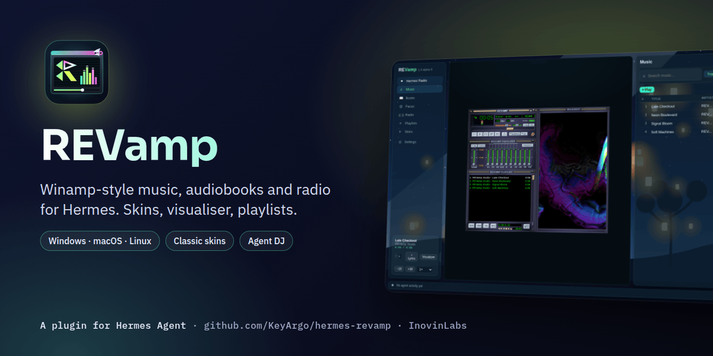
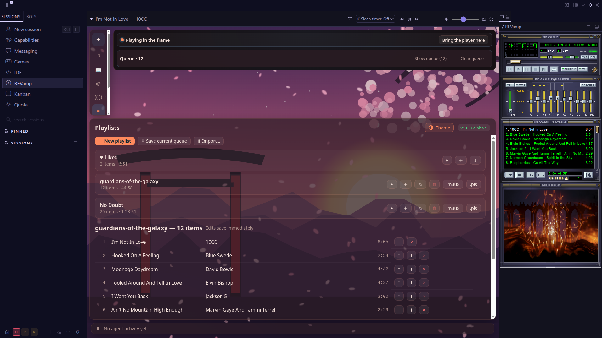
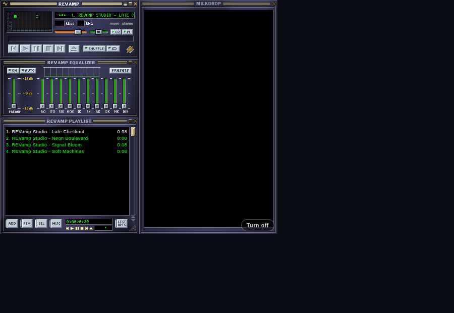
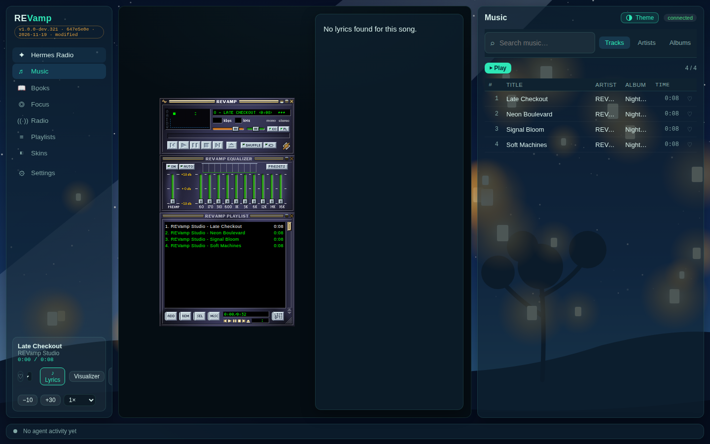
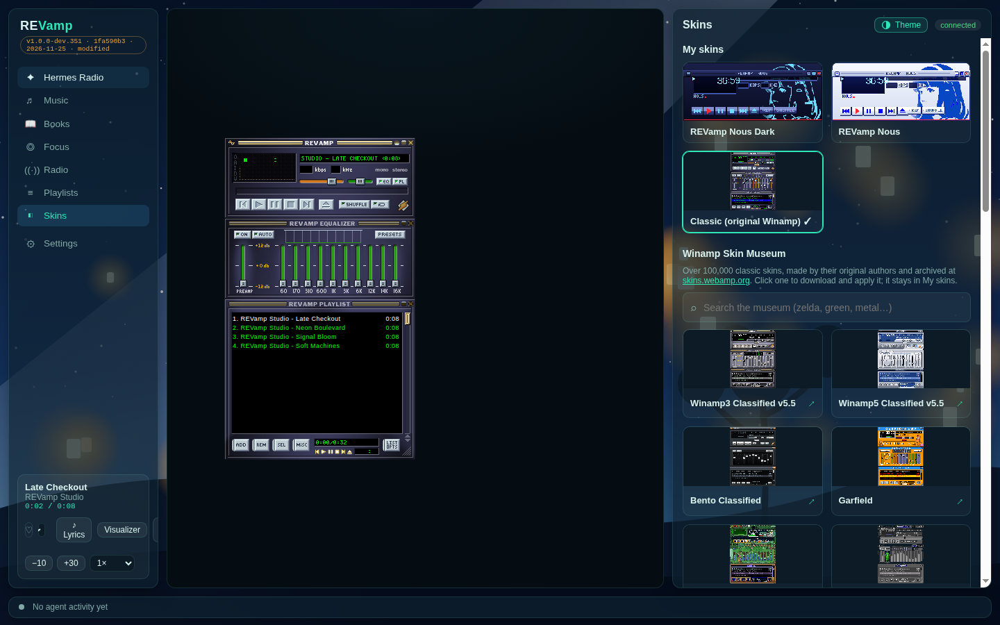
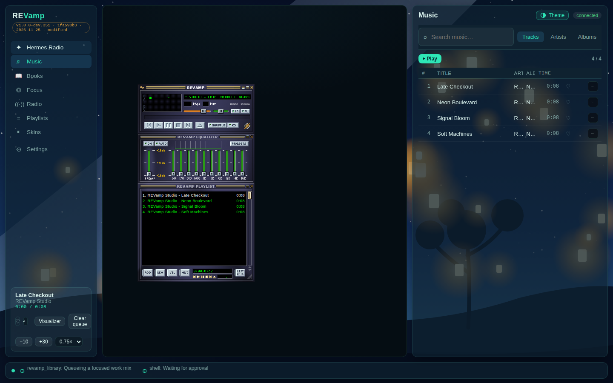

<p align="center">
  
</p>

<h1 align="center">REVamp</h1>

<p align="center"><em>A Winamp-style music, audiobook and radio player for Hermes, with classic skins and a MilkDrop visualizer.</em></p>

<p align="center">
  <a href="https://github.com/KeyArgo/hermes-revamp/releases/tag/v1.0.0"></a>
  
  
  
  
  
</p>

<p align="center">
  
  
  
</p>

<p align="center">
  
  <br/><sub>Designed banner: the REVamp player beside a classic skin and the MilkDrop visualizer.</sub>
</p>

<p align="center"><i>Applies to REVamp 1.0.0 · revised 2026-11-19 · <a href="CHANGELOG.md">changelog</a></i></p>

> **Status: 1.0 alpha.** REVamp works day to day, but rough edges remain. Please report bugs in Issues.

The version chip under the name reads `v1.0.0-dev.N · short sha · date`, taken from the running server's build stamp. It also appears sideways in the narrow rail and under the nav icons in Hermes Desktop. Click it to copy the line for a bug report.

---

## What it is

REVamp is a local-first player that lives beside your Hermes chat. It keeps a music and audiobook library in the player, with playlists, radio, lyrics, classic skins and a MilkDrop visualizer. You can run it as a small status-bar widget, a docked pane, a floating window, its own desktop window or full screen. The point is to manage and play your own library without leaving Hermes.

## Why it is different

One player state on a loopback server feeds every surface and the agent as well. The queue, volume and position are the same in the pane, the page, the pop-out and the agent tools. Hermes can DJ through four tools or an MCP server, while a ticker shows what the agent is doing. Optional chime and dip alerts flag approvals you can act on, without taking your eyes off the music. Your MilkDrop choice follows the player to each of its five places. Nothing is uploaded: there is no account, no telemetry and no stored password.

## Try it in five minutes

Install from the catalog when it is available, or from this repository:

```bash
hermes plugins install revamp
hermes plugins install https://github.com/KeyArgo/hermes-revamp
```

REVamp needs Hermes Agent 0.22.5 or newer. After installing, open **Capabilities → Plugins** in Hermes Desktop and switch REVamp on in both places: the agent part under General, and the Desktop part under the **Desktop** filter. The Desktop part adds the sidebar entry, the player and the status-bar controls. Then open REVamp from the sidebar.

Tags and durations are read in Python, so FFmpeg is not needed for those. `ffprobe` from FFmpeg is optional and is what audiobook chapters use. A Chrome or Chromium family browser is only needed for the optional external pop-out window.

### Use it from other agent apps

Start REVamp once, either from Hermes or with `python -m revamp_core.server`, then point the app at the stdio MCP server:

```json
{"mcpServers":{"revamp":{"command":"/absolute/path/to/revamp/bin/revampctl","args":["mcp"]}}}
```

The same command works in other agent apps that can run a stdio MCP server. Set `REVAMP_PORT` and `REVAMP_HOME` in that app's MCP environment if you use non-default values. The server token stays on disk and `revampctl` reads it itself, so no key is handed to the agent.

The bundled marketplace manifest can be added from the terminal plugin:

```bash
claude plugin marketplace add /absolute/path/to/revamp/.claude-plugin
claude plugin install revamp@revamp
```

The pi and omp extension is in `integrations/pi/revamp.ts`. Load that exact file with your extension configuration. It uses `revampctl` rather than exposing the token.

## What it does

<p align="center">
  
  <br/><sub>Docked in the Frame beside a Hermes chat, with MilkDrop running.</sub>
</p>

Pick a place from the player menu in the status bar:

- **Mini player**, a status bar widget only.
- **Frame**, a side pane on the right or left.
- **Pop into Hermes**, a floating window over the chat.
- **Pop out to desktop**, its own OS window.
- **Full screen**.

In narrow panes the player scales to fit and the menu becomes a compact row. In wide panes it scales up in crisp 2x, 3x and 4x steps. Library mode opens the full REVamp page while the player stays in its Frame or pop-out, so you can browse, queue and build playlists without moving the music.

<p align="center">
  
  
  <br/><sub>Left: popped out to its own desktop window, while the page in Hermes keeps the library and controls. Right: the Frame with the Sakura shrine look and a playlist open.</sub>
</p>

<p align="center">
  
  
  <br/><sub>Left: the mini player, radio genres and every place the player can go. Right: the classic skin with MilkDrop.</sub>
</p>

### Music, books and radio

Separate local Music and Books folders keep libraries apart. Search artists and albums, read cover art, build queues and likes, save playlists, and resume audiobooks with chapters and a speed control. Radio uses Radio Browser for popular stations ranked by listener votes, genre, country and language browsing, search, favourites and endless scrolling.

Albums and artists are right-clickable. In the Albums and Artists views, and in the Hermes mini player's Music tab, right-click, long-press, the ⋯ button, Shift+F10 or the context-menu key opens the same menu a song has: Play, Play next, Add to queue and Add to playlist.

<p align="center">
  
  
  <br/><sub>Left: classic player, EQ, playlist and the named Visualizer control. Right: the REVamp Nous light skin.</sub>
</p>

<p align="center">
  
  
  
  <br/><sub>Left to right: audiobook resume, speed and chapters; synced LRCLIB lyrics; Hermes Radio with Radio Browser search alongside it.</sub>
</p>

<p align="center">
  
  
  <br/><sub>Left: library artist browsing. Right: installed skins and the Winamp Skin Museum.</sub>
</p>

Also included: a focus drone, a sleep timer, the MilkDrop visualizer (Butterchurn), classic skins from the Winamp Skin Museum, and media keys and lock-screen controls where the browser and OS expose them.

### Looks

One tap in **Theme** sets the colours, the gradient, an illustrated scene and an optional animated backdrop together. Each part can be changed on its own, or you can use your own picture and accent colour.

| Lantern night | Moonlit girl |
|:---:|:---:|
|  |  |
| **Sakura shrine** | **Neon city** |
|  |  |

### Agent awareness

<p align="center">
  
  
  <br/><sub>Left: the agent activity ticker with a live tool event. Right: player settings, approval chime and dip controls, recovery backup actions and the event log.</sub>
</p>

The ticker shows what the agent is doing. Optional chime and dip alerts flag approvals you can act on. Turn those on under **Settings → REVamp → Music and approvals**. Four Hermes tools (`revamp_player`, `revamp_library`, `revamp_playlist`, `revamp_radio`) let the agent control playback, and `revampctl mcp` serves other agent apps.

## Works well with

Two sibling plugins that pair naturally with a music player. Neither is required; REVamp works alone.

- **Aura** — plays films and MilkDrop-style scenes in its own page or pane and listens to the system audio loopback, so the visuals react to whatever REVamp plays with no configuration. A quiet hint in REVamp's Settings (only when the visualizer is switched off) points to it in Capabilities → Plugins.
- **Music Studio** — turns a song idea into lyrics and a style you approve, then renders the audio locally (ACE-Step, or MiniMax via ComfyUI). Finished takes are plain `.wav` files; when REVamp finds that folder it offers one click to add it to your library, and empty-library / empty-playlist screens mention where it lives.

## Settings and shortcuts

Player settings live under **Settings → REVamp** in Hermes Desktop. That page holds the approval chime and dip controls, recovery backup actions and the event log. The player menu holds the five places, the EQ, skins and the named Visualizer control.

**Turn MilkDrop off** with the **Visualizer** button in the player, or press `Ctrl+Alt+Shift+V` (`Cmd+Option+Shift+V` on Mac). In the classic skin the Winamp menu also offers Visualizer (`Ctrl+Shift+M`). One saved choice covers every place the player can be, so closing MilkDrop in the Frame keeps it closed in the pop-out. The Mini player cannot show MilkDrop; switch out of Mini first. A machine without WebGL gets a plain error instead of a blank window.

Click the **×** at the top of the Frame to hide it. Your music keeps playing. Press `Ctrl+Alt+F` (`Cmd+Option+F` on Mac), or run **REVamp: Show / Hide Frame** from the command palette, to bring it back. All REVamp shortcuts are listed under REVamp in Hermes's Keyboard Shortcuts settings and can be changed there.

## Privacy and network

When Hermes loads the plugin, REVamp starts a token-protected server that listens only on `127.0.0.1` and runs for as long as Hermes runs. Every API route except `/api/health` requires `X-Revamp-Token`. On Linux the server also refuses connections from other local accounts: only the account that runs Hermes can reach it. macOS and Windows have no equivalent check, so any other local account on the same machine can reach the loopback server and load the token-bearing page, though the token still guards every API route except `/api/health`. REVamp reads Hermes configuration to resolve its settings. It scans `~/Music` by default; use the library settings, the `library_dirs` Hermes setting or `REVAMP_LIBRARY_DIRS` to change that folder or add others.

Radio Browser is contacted for station search and directory results. Playing radio contacts the station you choose and any redirects or playlist targets it uses. Browsing radio lists also fetches each listed station's logo from its own host, through REVamp, which only contacts public addresses. That covers built-in presets such as SomaFM, Radio Paradise, KEXP, BBC, NTS and WFMU, and any custom stream URL you add. Skin Museum browsing and downloads contact `api.webamp.org` and `r2.webampskins.org`; lyrics contact `lrclib.net`.

REVamp reads tags and durations itself. `mutagen` is optional: when it is installed REVamp uses it for tags and cover art, and without it the same fields come from `ffprobe` and the built-in parsers. It may also run `ffprobe` for audiobook chapters and as another tag source when FFmpeg is installed. Those scans run at low priority with `nice` and `ionice` when available. The external pop-out window is optional and opens a local Chrome or Chromium family browser with a private REVamp profile; the floating mini player inside Hermes does not launch that browser. On Linux, opening the pop-out writes two small desktop entries, one for X11 and one for Wayland, and icon files under `~/.local/share`, so its window shows the REVamp icon.

REVamp makes private automatic backups every 10 minutes under `$XDG_DATA_HOME/revamp/backups/` (`~/.local/share/revamp/backups/` when unset, `%LOCALAPPDATA%\revamp\backups\` on Windows, or `REVAMP_BACKUP_DIR`) and stores a short, credential-masked local record of agent activity for the player ticker. State lives in `$REVAMP_HOME`, otherwise the active Hermes profile home (Hermes's own resolver, falling back to `$HERMES_HOME`)/`revamp`, otherwise `~/.hermes/revamp`. It holds the library index, playlists, likes, settings, server token, lyric cache, installed skins and pop-out browser profile. There are no accounts, no telemetry, no usage analytics and no stored passwords.

## Troubleshooting

- If the mini player is offline, choose **Reconnect**. The server keeps its queue and position.
- If the mini player is gone after a restart, Hermes is probably in Simple mode, which hides the status bar each time it starts. Switch to Advanced from the command palette. `Ctrl+Shift+S` (`Cmd+Shift+S` on Mac) shows the bar until the next restart.
- Reopen Hermes after a plugin update. **REVamp: Reload Player** reloads the player view, its embedded iframe, not the installed plugin or an update.
- Set `REVAMP_FLOAT_BROWSER` to a Chrome or Chromium executable when pop-out browser discovery fails.
- Install FFmpeg for `ffprobe` if audiobook chapters are missing. Durations and basic tags are read without it.
- For a slow leak, a stalled server or a file that will not scan, read `~/.hermes/revamp/logs/revamp.log` (or `<REVAMP_HOME>/logs/revamp.log`). It is private to you, rotates at 1 MB with three backups, and writes one health line a minute with memory, threads, open files, SSE clients and uptime. It warns when memory jumps, threads pass 200 or open files pass 1000. Set `REVAMP_LOG_LEVEL=DEBUG` to see per-file problems, or `REVAMP_TRACEMALLOC=1` to add memory allocation tracking to the warnings. `GET /api/diagnostics` needs the REVamp token and shows the latest health line and the log path.
- Turning the MilkDrop visualizer off saves CPU and GPU: use the **Visualizer** button in the player or the switch in Settings.

## Limits

| Area | Status |
|---|---|
| Release stage | 1.0 alpha. It works day to day, but rough edges remain. |
| Access | The server binds to `127.0.0.1` only. There is no remote access mode. |
| Media keys | Available only where the browser and OS expose them. |
| Pop-out window | Needs a local Chrome or Chromium family browser. Set `REVAMP_FLOAT_BROWSER` if discovery fails. |
| Audiobook chapters | Need `ffprobe`. Basic tags and durations do not. |
| External services | Radio, lyrics, station logos and Skin Museum need their public hosts reachable. Local playback does not. |
| Browser end-to-end tests | Run on Ubuntu in CI. The Python suite covers all three platforms. |

## Tests

```bash
.venv/bin/python -m pytest -q -p no:cacheprovider --deselect tests/test_nav_rail_e2e.py
# 962 passed, 16 skipped, 12 deselected (measured 2026-11-19, Python 3.12)
```

CI runs one Python process per test file across Linux, Windows and macOS, with a separate Ubuntu job for browser end-to-end tests.

## Platform support

| Platform | Status |
|---|---|
| Linux | tests pass locally and the CI matrix covers Ubuntu |
| macOS | CI matrix only; not tested locally |
| Windows | CI matrix only; not tested locally |

## Uninstall

```bash
hermes plugins uninstall revamp
```

This removes the plugin, not your REVamp data or backups. Remove the configured REVamp data directory only if you want to erase local state.

## Contributing

See [CONTRIBUTING.md](CONTRIBUTING.md), [docs/EXTENDING.md](docs/EXTENDING.md), [docs/SOURCES.md](docs/SOURCES.md) and [SECURITY.md](SECURITY.md).

## Licence and credits

REVamp is [MIT licensed](LICENSE). Narrow-pane layout, themes and the illustrated scenes are by [@Pukujan](https://github.com/Pukujan) ([PR #1](https://github.com/KeyArgo/hermes-revamp/pull/1)). [THIRD_PARTY_NOTICES.md](THIRD_PARTY_NOTICES.md) carries the Webamp, Butterchurn, Radio Browser, LRCLIB and Skin Museum notices.

---

<p align="center">
  
  <br/>
  <sub>Built by <strong>InovinLabs</strong>. MIT licensed.</sub>
  <br/>
  <sub>Sibling tools:
  <a href="https://github.com/inovinlabs/hermes-omniscience">Omniscience</a> ·
  <a href="https://github.com/inovinlabs/hermes-gameshelf">Game Center</a> ·
  <a href="https://github.com/inovinlabs/hermes-music-studio">Music Studio</a> ·
  <a href="https://github.com/inovinlabs/hermes-movie-studio">Movie Studio</a> ·
  <a href="https://github.com/inovinlabs/hermes-aura">Aura</a> ·
  <a href="https://github.com/inovinlabs/hermes-hail">Hail</a> ·
  <a href="https://github.com/inovinlabs/hermes-design-studio">Design Studio</a> ·
  <a href="https://github.com/inovinlabs/hermes-antisloop">Anti-Slop</a></sub>
</p>
