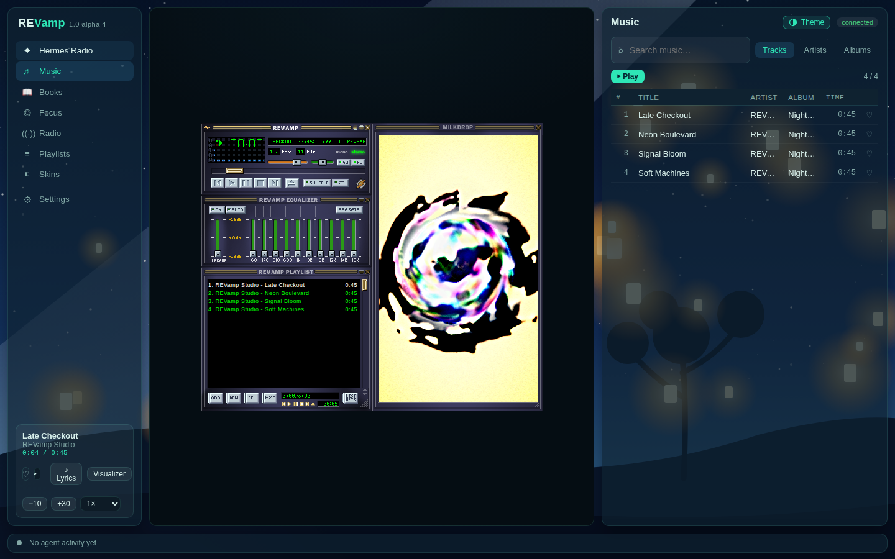
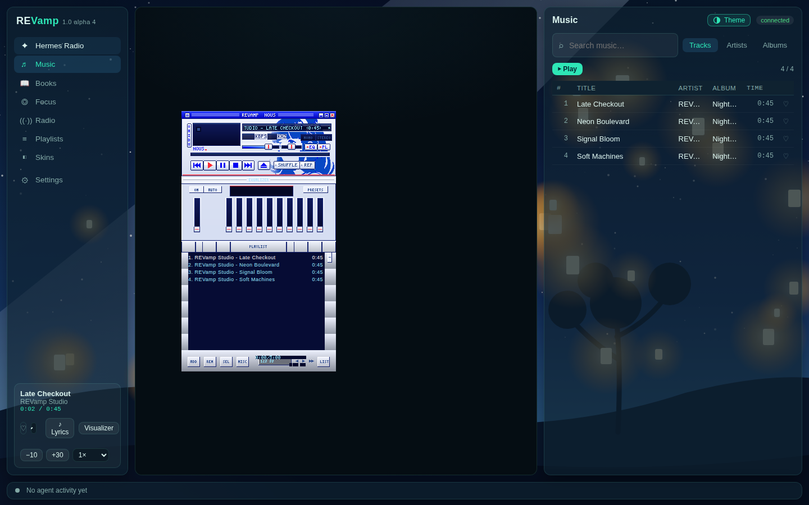
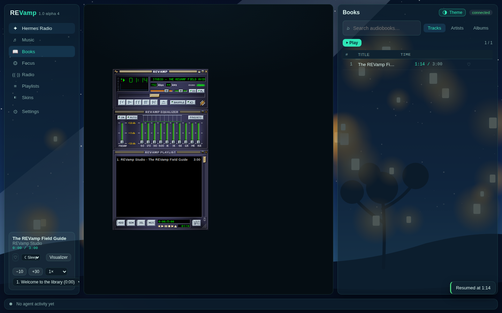
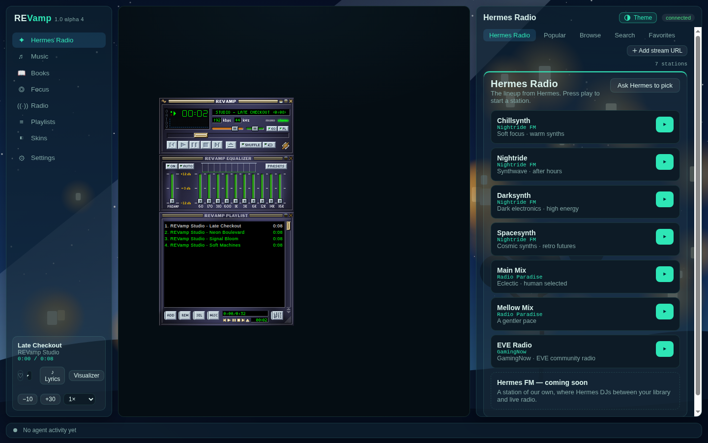
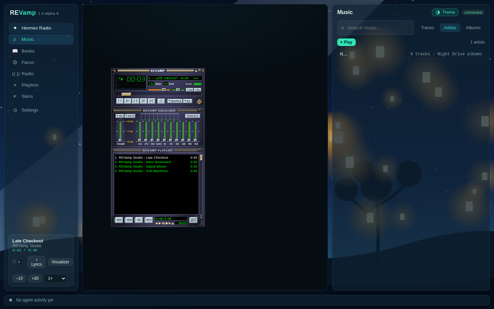
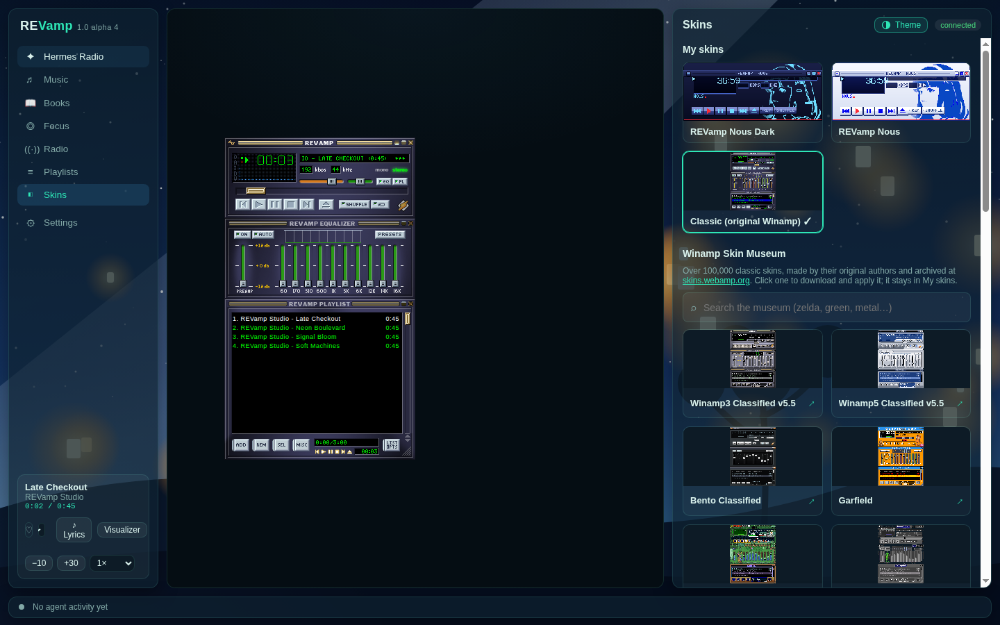
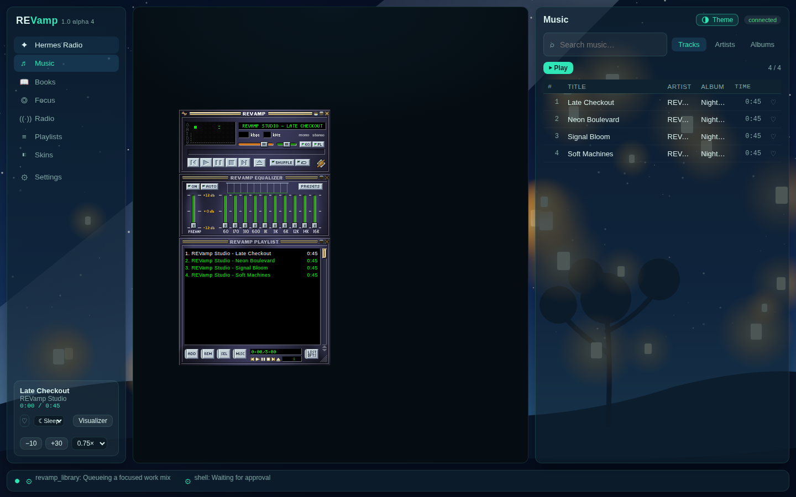
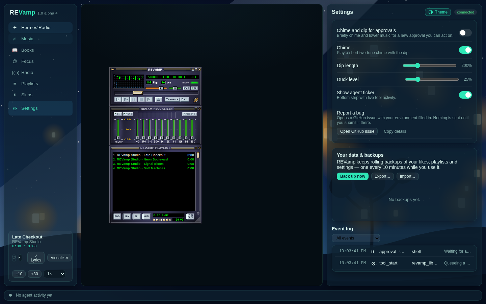

<p align="center">
  <picture>
    <source media="(prefers-color-scheme: dark)" srcset="assets/logo/logo.svg">
    
  </picture>
</p>

# REVamp

REVamp is a retro-inspired, local-first music and audiobook player for Hermes Agent.

> **1.0 alpha.** REVamp works day to day, but expect rough edges. Please report bugs in Issues.



*The full player opened in a browser at its local address (`revampctl url`). Inside Hermes Desktop the same player shows as a tab.*

REVamp keeps your library close while adding playlists, radio, lyrics, a MilkDrop visualizer, classic skins, and agent-aware playback controls.

## Features

- **Five places for the player:** Mini player (status bar only), Frame (a side pane on the right or left), Pop into Hermes (floating), Pop out to desktop (its own window), and Full screen. Pick from the player menu in the status bar.
- **Works in any size:** in narrow panes the player scales to fit and the menu becomes a compact row; in wide panes it scales up in crisp 2x/3x/4x steps.
- **Library mode:** open the full REVamp page while the player stays in its Frame or pop-out, and browse, queue and build playlists there.
- Separate local Music and Books folders, searchable artists and albums, cover art, queues, likes, playlists, and audiobook resume, chapters, and speed.
- **Radio:** popular stations ranked by listener votes, browse by genre, country and language, search, favourites, and endless scrolling, through Radio Browser.
- **Themes:** one-tap Looks for the REVamp page (colour scheme, gradient, an illustrated scene and an optional animated backdrop), or your own picture and accent colour.
- Focus drone, sleep timer, synced LRCLIB lyrics, the MilkDrop visualizer (Butterchurn), and classic skins from the Winamp Skin Museum.
- Media keys and lock-screen controls where the browser and OS expose them.
- Hermes tools (`revamp_player`, `revamp_library`, `revamp_playlist`, and `revamp_radio`) plus `revampctl mcp` for other agent apps.
- **Agent-aware:** a ticker shows what the agent is doing, and optional chime-and-dip alerts briefly flag approvals you can act on (Settings → REVamp → Music and approvals).

## Install in Hermes Desktop

Install from the published catalog when available:

```bash
hermes plugins install revamp
```

For a checkout or a git URL, use Hermes’s git install flow:

```bash
hermes plugins install https://github.com/KeyArgo/hermes-revamp
```

REVamp requires Hermes Agent 0.22.5 or newer. **After installing, open Capabilities → Plugins in Hermes Desktop and make sure REVamp is switched on.** REVamp has two parts there: the agent part (under General) and the Desktop part (click the **Desktop** filter), which adds the sidebar entry, the player and the status-bar controls. Both should be on. Then open REVamp from the sidebar. Tags and durations are read in Python, so FFmpeg is not required for those. `ffprobe` (from FFmpeg) is optional and is what audiobook chapters use. A Chrome/Chromium-family browser is only needed for the optional external pop-out window.

## Use from other agent apps

Start REVamp once (for example from Hermes, or `python -m revamp_core.server`) and point the app at the stdio MCP server:

```json
{"mcpServers":{"revamp":{"command":"/absolute/path/to/revamp/bin/revampctl","args":["mcp"]}}}
```

This same command works for Codex, OpenCode, agy, and Cursor; set `REVAMP_PORT` and `REVAMP_HOME` in that app’s MCP environment if you use non-default values. The server token stays on disk and `revampctl` reads it itself.

Claude Code can discover the included marketplace manifest:

```bash
claude plugin marketplace add /absolute/path/to/revamp/.claude-plugin
claude plugin install revamp@revamp
```

The pi/omp extension is in `integrations/pi/revamp.ts`; load that exact file with your pi/omp extension configuration. It uses `revampctl` rather than exposing the token to the agent.


## Privacy and network disclosure

When Hermes loads the plugin, REVamp starts a token-protected server that listens only on `127.0.0.1` and runs for as long as Hermes runs. Every API route except `/api/health` requires `X-Revamp-Token`. REVamp reads Hermes configuration to resolve its settings. It scans `~/Music` by default; use the library settings or the `library_dirs` Hermes setting (or `REVAMP_LIBRARY_DIRS`) to change that folder or add others.

Radio Browser is contacted for station search and directory results. Playing radio contacts the station you choose, any redirects or playlist targets it uses, and its favicon host. That includes built-in presets such as SomaFM, Radio Paradise, KEXP, BBC, NTS, and WFMU, as well as any custom stream URL you add. Skin Museum browsing/downloads contact `api.webamp.org` and `r2.webampskins.org`; lyrics contact `lrclib.net`.

REVamp reads tags and durations itself. It may also run `ffprobe` for audiobook chapters, and as another tag source when FFmpeg is installed; those scans run at low priority with `nice` and `ionice` when those tools are available. Its external pop-out window is optional and launches a local Chrome/Chromium-family browser with a private REVamp profile; the in-Hermes floating mini player does not launch that browser. On Linux, opening that pop-out writes two small desktop entries (one for X11, one for Wayland) and icon files under `~/.local/share` so its window shows the REVamp icon. It makes private automatic backups every 10 minutes under `~/.local/share/revamp/backups/` (or `REVAMP_BACKUP_DIR`) and stores a short, credential-masked local record of agent activity for the player ticker.

State lives in `$REVAMP_HOME`, otherwise `$HERMES_HOME/revamp`, otherwise `~/.hermes/revamp`; it includes the library index, playlists, likes, settings, server token, lyric cache, installed skins, and pop-out browser profile. REVamp has no accounts, telemetry, usage analytics, or stored passwords.

## Screenshots


Classic player, EQ, playlist, and the named Visualizer control for MilkDrop.



REVamp Nous light skin on the full player page.



Audiobook resume position, speed, and chapter picker.



Hermes Radio: a curated station lineup, with Radio Browser search, genres, countries, and languages available alongside it.



Library artist browsing.



Installed skins and the Skin Museum.



Agent activity ticker with a live tool event.



Player settings, approval chime/dip controls, recovery backup actions, and the event log.

## Troubleshooting

- If the mini player is offline, choose **Reconnect**; the server keeps its queue and position.
- Reopen Hermes after a plugin update. **REVamp: Reload Player** reloads the player view (its embedded iframe), not the installed plugin or an update.
- Set `REVAMP_FLOAT_BROWSER` to a Chrome/Chromium executable when pop-out browser discovery fails.
- Install FFmpeg for `ffprobe` if audiobook chapters are missing. Durations and basic tags are read without it.

## Uninstall

```bash
hermes plugins uninstall revamp
```

This removes the plugin, not your REVamp data or backups. Remove the configured REVamp data directory only if you explicitly want to erase local state.

## Contributing

See [CONTRIBUTING.md](CONTRIBUTING.md), [docs/EXTENDING.md](docs/EXTENDING.md), and [SECURITY.md](SECURITY.md).

## License and credits

REVamp is [MIT licensed](LICENSE). Narrow-pane layout, themes and the illustrated scenes by [@Pukujan](https://github.com/Pukujan) ([#1](https://github.com/KeyArgo/hermes-revamp/pull/1)). See [THIRD_PARTY_NOTICES.md](THIRD_PARTY_NOTICES.md) for Webamp, Butterchurn, Radio Browser, LRCLIB, and Skin Museum notices.
