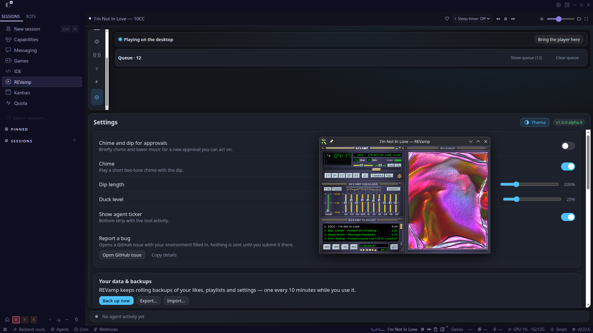
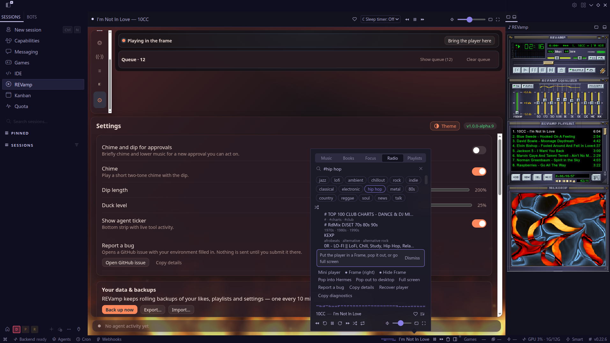
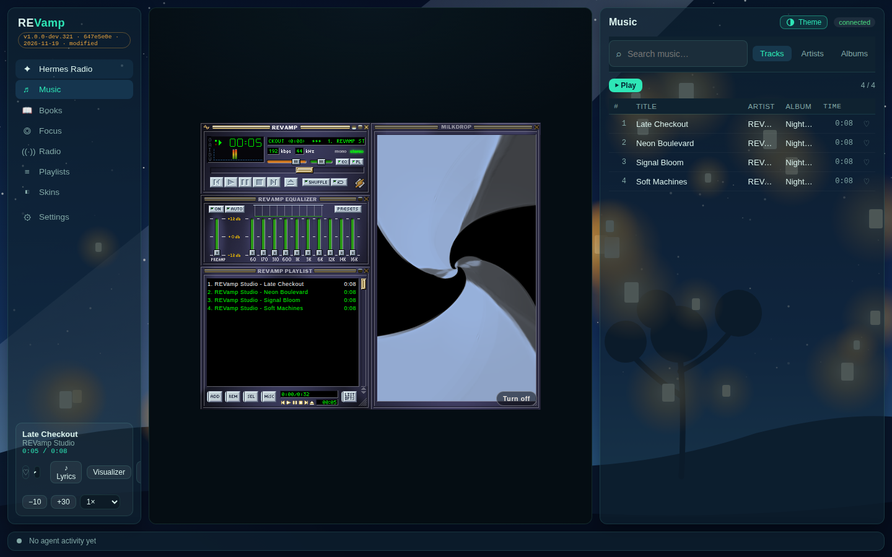
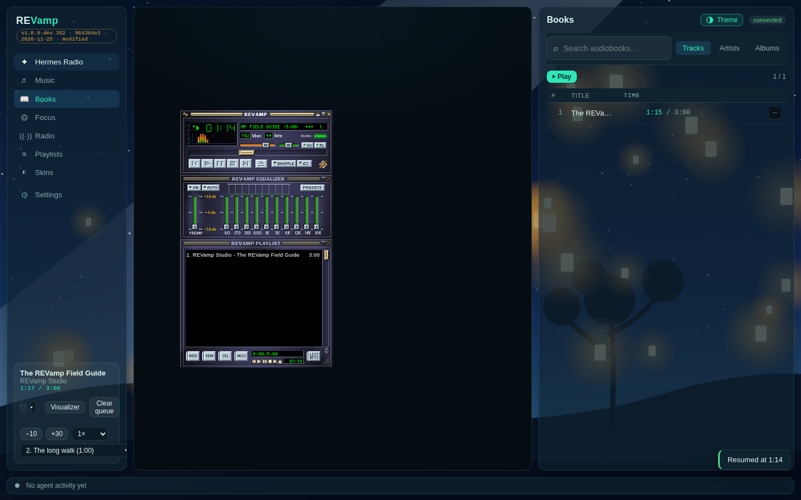
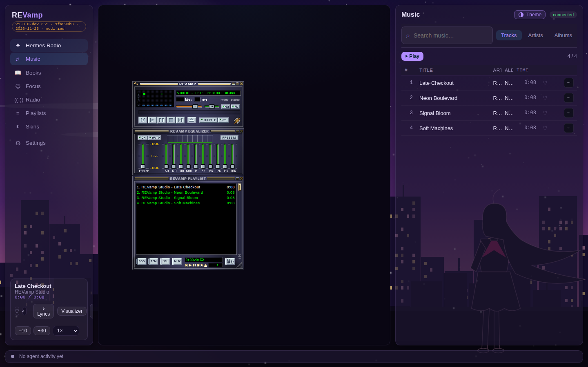
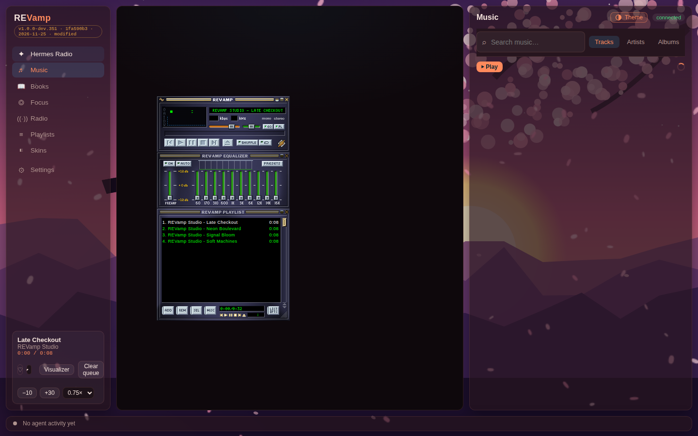
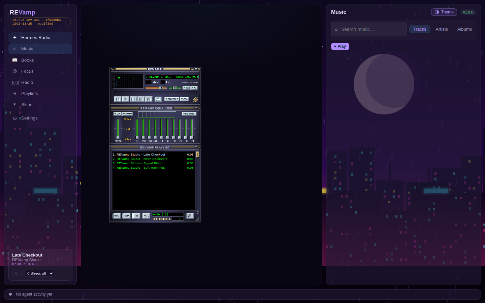
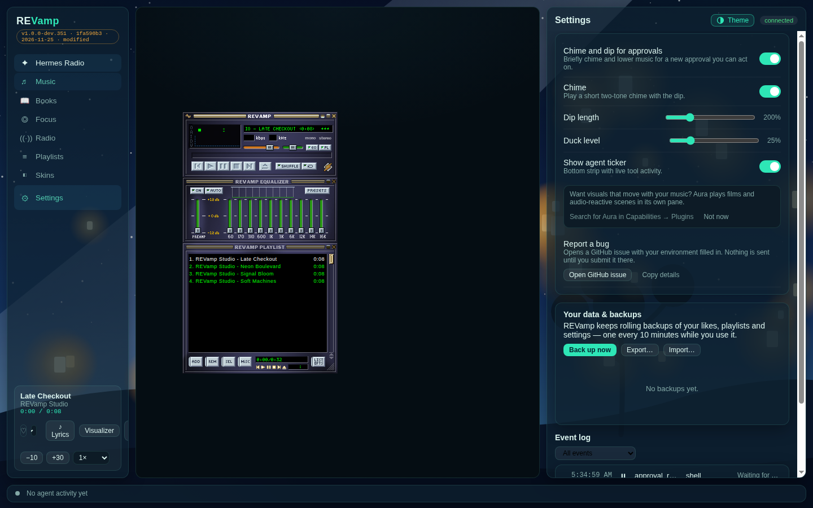

<p align="center">
  <picture>
    <source media="(prefers-color-scheme: dark)" srcset="assets/logo/logo.svg">
    
  </picture>
</p>
<p align="center"><em>Your music, your audiobooks and internet radio, in a Winamp-style player that lives inside Hermes — and that your agent can DJ.</em></p>

_Applies to REVamp 1.0.0 · last revised 2026-11-14_

<p align="center">
  <a href="https://github.com/KeyArgo/hermes-revamp/actions/workflows/tests.yml"></a>
  <a href="VERIFY.md"></a>
  <a href="https://github.com/NousResearch/hermes-agent/blob/main/plugin-catalog/revamp.yaml"></a>
  <a href="LICENSE"></a>
  <a href="https://github.com/NousResearch/hermes-agent"></a>
  <a href="plugin.yaml"></a>
  <a href=".github/workflows/tests.yml"></a>
  <a href="https://github.com/KeyArgo/hermes-revamp/stargazers"></a>
</p>


<p align="center"><em>REVamp docked in the Frame beside a Hermes chat, with MilkDrop running.</em></p>

<p align="center"><a href="#install">Install</a> · <a href="#features">Features</a> · <a href="#how-it-works">How it works</a> · <a href="#works-well-with-revamp">Works well with</a> · <a href="#privacy-and-security">Privacy</a> · <a href="#testing">Testing</a> · <a href="#contributing">Contributing</a></p>

## What it is

REVamp is a local-first music and audiobook player for Hermes Agent, built on Webamp: the classic
Winamp windows, skins and the MilkDrop visualizer, with a modern library around them. It plays the
files in your own folders and internet radio, keeps your place in every audiobook, and gives your
Hermes agent four tools to search, queue and play for you.

Everything runs on your computer. The player's server listens only on `127.0.0.1`, every request but
a health check needs a per-install token, and there are no accounts, telemetry or analytics.

## Features

- **Five places for the player.** The mini player in the status bar, the Frame (a side pane on the
  right or left), floating inside Hermes, popped out to its own desktop window, or full screen. Pick
  one from the player menu; the music keeps playing as it moves.
- **Your library.** Separate Music and Books folders, searchable artists and albums, cover art,
  queues, likes and playlists. Tags and durations are read in Python, so FFmpeg is not required.
- **Audiobooks that remember.** Resume where you stopped (even in books split over many files),
  chapters, and playback speed.
- **Radio.** Popular stations ranked by listener votes, browse by genre, country and language,
  search, favourites, and the Hermes Radio lineup, through Radio Browser.
- **The Winamp feel.** Classic skins from the Winamp Skin Museum, the MilkDrop visualizer
  (Butterchurn), an equalizer, synced lyrics from LRCLIB, a focus drone and a sleep timer.
- **Looks.** One tap sets the REVamp page's colours, an illustrated scene and an animated backdrop,
  or use your own picture and accent colour.
- **Agent-aware.** Hermes can search, queue, play and build playlists with `revamp_player`,
  `revamp_library`, `revamp_playlist` and `revamp_radio`. A ticker shows what the agent is doing, and
  optional chime-and-dip alerts flag approvals waiting for you.
- **Other agent apps too.** `revampctl mcp` serves the same tools over MCP to Codex, Cursor,
  OpenCode, Claude Code and others.
- **Works in any size**, with media keys and lock-screen controls where the OS exposes them.

## Screenshots

| In the Frame, Sakura shrine look | Its own desktop window |
|:---:|:---:|
|  |  |
| **The mini player and its place menu** | **Classic player, EQ, playlist and MilkDrop** |
|  |  |
| **Audiobooks: resume, speed and chapters** | **Hermes Radio and Radio Browser** |
|  |  |
| **Library artists** | **Installed skins and the Skin Museum** |
|  |  |

<details>
<summary><b>More: Looks, the Nous skin, agent activity and settings</b></summary>

| Lantern night | Moonlit girl |
|:---:|:---:|
|  |  |
| **Sakura shrine** | **Neon city** |
|  |  |


*The REVamp Nous light skin on the full player page.*


*The agent activity ticker with a live tool event.*


*Player settings, approval chime and dip, recovery and backups, and the event log.*

</details>

## Install

From the Hermes plugin catalog:

```bash
hermes plugins install revamp
```

Or from GitHub (the newest code, or a fork):

```bash
hermes plugins install KeyArgo/hermes-revamp
```

REVamp needs Hermes Agent 0.22.5 or newer. **After installing, open Capabilities → Plugins in Hermes
Desktop and make sure REVamp is switched on.** It has two parts there: the agent part (under General)
and the Desktop part (the **Desktop** filter), which adds the sidebar entry, the player and the
status-bar controls. Both should be on.

Optional extras: `ffprobe` (from FFmpeg) for audiobook chapters, and a Chrome-family browser for the
pop-out desktop window. Nothing else is needed.

## Quick start

1. Open **REVamp** from the sidebar. It scans `~/Music` by default; add or change folders under
   **Library**.
2. Pick music, a book or a radio station; it plays in the Frame beside the chat.
3. Use the player menu in the status bar to move it: mini, Frame, floating, desktop window or full
   screen.
4. Ask Hermes: *"Play some Miles Davis from my library"* or *"Make a playlist called Road Trip with
   everything by Queen."*

To hide the Frame, click its **×**; the music keeps playing. `Ctrl+Alt+F` (`Cmd+Option+F` on Mac)
brings it back. All of REVamp's shortcuts are listed, and can be changed, under REVamp in Hermes's
Keyboard Shortcuts settings.

## How it works

```
Hermes agent ──tools──► REVamp server (127.0.0.1, token) ◄──── player page (Webamp + library UI)
Hermes Desktop ─SDK──► desktop/plugin.js ──moves one live player──► Frame · floating · page · mini
Other agent apps ──MCP──► revampctl ──────────┘
```

- **One server, one player.** The Python half starts a small token-protected server when Hermes loads
  the plugin. The player page (Webamp plus REVamp's library, radio and books views) talks only to it.
- **The player never reloads when it moves.** Hermes Desktop's half keeps one live player and moves it
  between the Frame, the floating window and the full page, so music and MilkDrop keep going. Several
  Hermes windows share it: one plays, the others show its controls.
- **The agent and the page use the same commands**, so the queue, volume and history agree whoever
  pressed play.
- **The version chip** (Settings → REVamp, the player header, and the status-bar menu) shows the
  running build as `v1.0.0-dev.N · date · commit`; click it to copy that line into a bug report.

## Use from other agent apps

Start REVamp once (from Hermes, or `python -m revamp_core.server`) and point the app at the stdio MCP
server:

```json
{"mcpServers":{"revamp":{"command":"/absolute/path/to/revamp/bin/revampctl","args":["mcp"]}}}
```

The same command works for Codex, OpenCode, agy and Cursor; set `REVAMP_PORT` and `REVAMP_HOME` in that
app's MCP environment if you use non-default values. The token stays on disk; `revampctl` reads it
itself.

Claude Code can discover the included marketplace manifest:

```bash
claude plugin marketplace add /absolute/path/to/revamp/.claude-plugin
claude plugin install revamp@revamp
```

The pi/omp extension is `integrations/pi/revamp.ts`; it uses `revampctl` rather than handing the token
to the agent.

## Works well with REVamp

Two more Hermes plugins from the same maker. Both are optional, and REVamp never installs anything
for you. They are also at the bottom of **Settings → REVamp**, where **Find in Plugins** opens
Hermes's Capabilities → Plugins and **Marketplace** opens each one's Hermes Marketplace page (GitHub
until its catalog listing is approved; both are in review).

| | |
|---|---|
| **[Aura](https://github.com/KeyArgo/hermes-aura)** | A MilkDrop visualiser behind all of Hermes that moves with whatever plays (REVamp included), and a film pane for watching while you work. Linux first. `hermes plugins install KeyArgo/hermes-aura` |
| **[Music Studio](https://github.com/KeyArgo/hermes-music-studio)** | Describe a song, approve the lyrics, and render it on your own GPU. Send the songs you like to a "Music Studio" playlist in REVamp. `hermes plugins install KeyArgo/hermes-music-studio` |

## Privacy and security

- **Local only.** The server listens on `127.0.0.1` for as long as Hermes runs. Every `/api/*` route
  except `/api/health` requires the per-install token in `X-Revamp-Token`.
- **What it reads.** Hermes configuration (to find its settings) and your music folders (`~/Music` by
  default; change them in the library settings, the `library_dirs` Hermes setting or
  `REVAMP_LIBRARY_DIRS`).
- **What it contacts.** Radio Browser for station search; the stations you play and their logo
  hosts (public addresses only); `api.webamp.org` and `r2.webampskins.org` for the Skin Museum;
  `lrclib.net` for lyrics. Nothing else.
- **What it runs.** `ffprobe` at low priority for chapters and extra tags when installed, and a
  Chrome-family browser only if you pop the player out. These programs get a minimal environment:
  never Hermes's API keys.
- **What it writes.** Its own data folder (`$REVAMP_HOME`, otherwise `$HERMES_HOME/revamp`, otherwise
  `~/.hermes/revamp`): library index, playlists, likes, settings, token, lyric cache, skins and the
  pop-out profile. Private backups every 10 minutes under `~/.local/share/revamp/backups/` (or
  `REVAMP_BACKUP_DIR`). A short, credential-masked record of agent activity for the ticker. On Linux,
  the pop-out writes two desktop entries and icons under `~/.local/share`.
- **What it never does.** No accounts, telemetry, analytics or stored passwords, and it never writes
  to your music files.

See [SECURITY.md](SECURITY.md) to report a vulnerability privately.

## Troubleshooting

- **The mini player says offline:** choose **Reconnect**; the server keeps the queue and position.
- **The mini player is gone after a restart:** Hermes is probably in Simple mode, which hides the
  status bar. Switch to Advanced from the command palette; `Ctrl+Shift+S` (`Cmd+Shift+S`) shows the bar
  until the next restart.
- **After an update:** reopen Hermes. **REVamp: Reload Player** reloads the player view, not the
  installed plugin.
- **The pop-out can't find a browser:** set `REVAMP_FLOAT_BROWSER` to a Chrome or Chromium executable.
- **Audiobook chapters are missing:** install FFmpeg for `ffprobe`. Durations and tags work without it.
- **Reporting a bug:** Settings → REVamp → **Copy diagnostics**, and click the version chip to copy
  the build; paste both into the [bug form](https://github.com/KeyArgo/hermes-revamp/issues/new/choose).

## Testing

```bash
python tools/run_tests_per_file.py          # the Python suite, one process per file (as CI runs it)
for t in tests/*.test.mjs; do node --test "$t"; done   # browser-side logic
```

The suite is offline. CI runs it on Linux, macOS and Windows (Python 3.11), Windows on Python 3.13,
and a separate browser job with headless Chrome. [VERIFY.md](VERIFY.md) lists each claim with the
command that checks it and the measured result.

## Limits

REVamp plays your files and internet radio; it does not connect to streaming services or media
servers, sync between computers, or edit your tags. Chapters need `ffprobe` and the pop-out needs a
Chrome-family browser. The full list is in [LIMITS.md](LIMITS.md).

## Uninstall

```bash
hermes plugins uninstall revamp
```

This removes the plugin, not your REVamp data or backups. Delete the REVamp data folder only if you
want to erase your library index, playlists and places.

## Contributing

Bug reports and pull requests are welcome. Start with [CONTRIBUTING.md](CONTRIBUTING.md),
[docs/EXTENDING.md](docs/EXTENDING.md) for adding a music source, and the
[Code of Conduct](CODE_OF_CONDUCT.md). Every fix comes with a test that fails without it.

## License and credits

REVamp is [MIT licensed](LICENSE). Narrow-pane layout, themes and the illustrated scenes by
[@Pukujan](https://github.com/Pukujan) ([#1](https://github.com/KeyArgo/hermes-revamp/pull/1),
[#2](https://github.com/KeyArgo/hermes-revamp/pull/2)). Built on [Webamp](https://github.com/captbaritone/webamp)
and [Butterchurn](https://github.com/jberg/butterchurn); stations from [Radio Browser](https://www.radio-browser.info/),
lyrics from [LRCLIB](https://lrclib.net/) and skins from the [Winamp Skin Museum](https://skins.webamp.org/).
See [THIRD_PARTY_NOTICES.md](THIRD_PARTY_NOTICES.md) for their licences.
