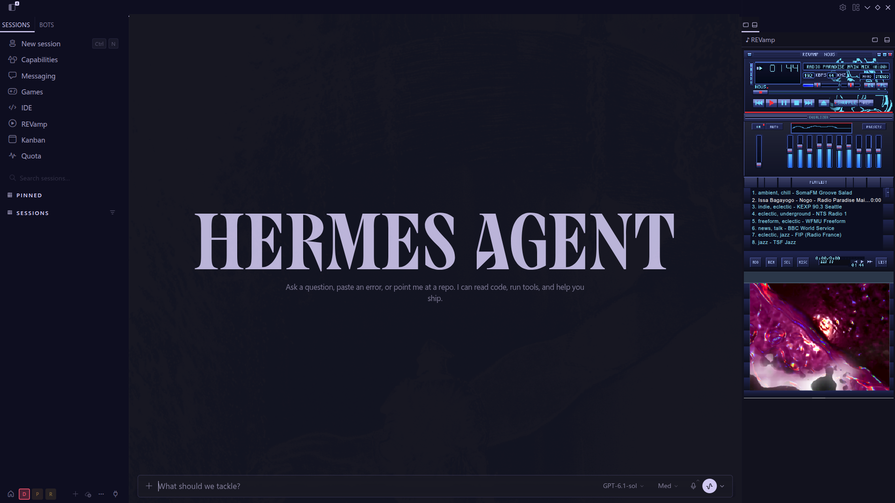
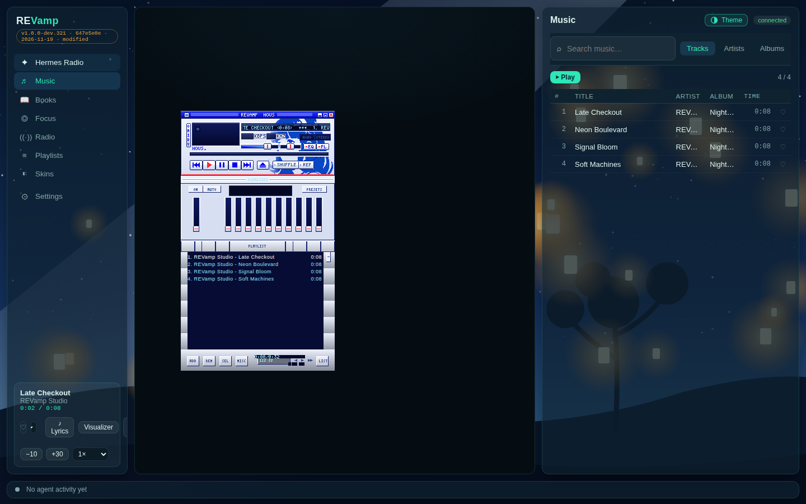
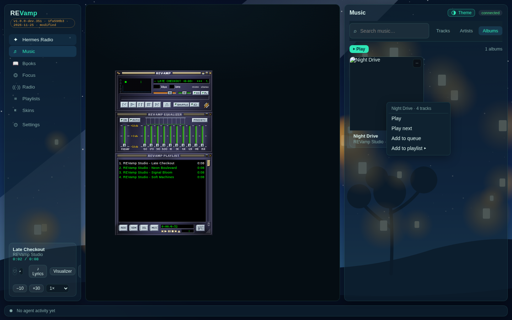
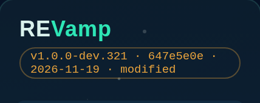
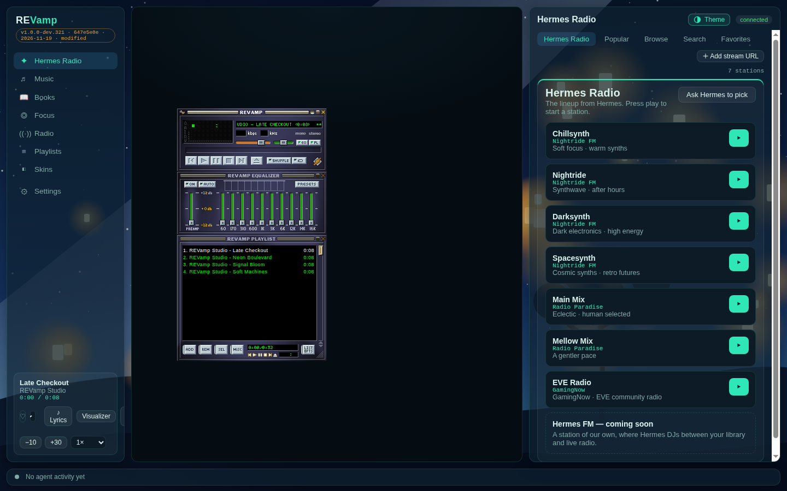

<p align="center">
  
</p>

<h1 align="center">REVamp</h1>

<p align="center"><em>A Winamp-style music, audiobook and radio player for Hermes, with classic skins and a MilkDrop visualizer.</em></p>

<p align="center">
  <a href="https://github.com/KeyArgo/hermes-revamp/releases/tag/v1.0.0"></a>
  
  
  
  
  
</p>

<p align="center">
  
  
  
</p>

<p align="center">
  
  <br/><sub>Docked in the Frame beside a Hermes chat, with the MilkDrop visualizer running.</sub>
</p>

<p align="center"><i>Applies to REVamp 1.0.0 · revised 2026-11-19 · <a href="CHANGELOG.md">changelog</a></i></p>

The version chip under the name reads `v1.0.0 · sha · date` on the tagged release or `v1.0.0-dev.N · sha · date` on a development build. The server supplies the short commit hash and date. It also appears sideways in the narrow rail and under the nav icons in Hermes Desktop. Click it to copy the line for a bug report.

---

## What it is

REVamp is a local-first player that lives beside your Hermes chat. It keeps a music and audiobook library in the player, with playlists, radio, lyrics, classic skins and a MilkDrop visualizer. Run it as a small status-bar widget, a docked pane, a floating window, its own desktop window or full screen. The point is to manage and play your own library without leaving Hermes.

## Why it is different

One player state on a loopback server feeds every surface and the agent as well. The queue, volume and position are the same in the pane, the page, the pop-out and the agent tools. Hermes can DJ through four tools or an MCP server, while a ticker shows what the agent is doing. Optional chime and dip alerts flag approvals you can act on, without taking your eyes off the music. Your MilkDrop choice follows the player to each of its five places. Nothing is uploaded: there is no account, no telemetry and no stored password.

## Try it in five minutes

REVamp needs Hermes Agent 0.22.5 or newer.

1. Install from this repository (or from the catalog by name once it is listed there):

   ```bash
   hermes plugins install KeyArgo/hermes-revamp
   ```

   You should see the installer fetch the plugin and add it to your plugins list.

2. Open **Capabilities → Plugins** in Hermes Desktop and switch REVamp on in both places: the agent part under **General**, and the Desktop part under the **Desktop** filter. The Desktop part adds the sidebar entry, the player and the status-bar controls. You should see REVamp appear in the sidebar and the status bar.

3. Open REVamp from the sidebar. You should see the player page: the classic player in the middle, your library on the right, and the version chip under the REVamp name. The default library scans `~/Music`; change or add folders using **Folders** in **Music** or **Books**, the `library_dirs` Hermes setting, or `REVAMP_LIBRARY_DIRS`.

4. Double-click a track, or press play. You should hear it, and see the position advance in every place the player is open.

Tags and durations are read in Python, so FFmpeg is not needed for those. `ffprobe` from FFmpeg is optional and is what audiobook chapters use. A Chrome or Chromium family browser is only needed for the optional external pop-out window.

### Use it from other agent apps

Start REVamp once, either from Hermes or with `python -m revamp_core.server`, then point the app at the stdio MCP server:

```json
{"mcpServers":{"revamp":{"command":"/absolute/path/to/revamp/bin/revampctl","args":["mcp"]}}}
```

The same command works in other agent apps that can run a stdio MCP server. Set `REVAMP_PORT` and `REVAMP_HOME` in that app's MCP environment if you use non-default values. The server token stays on disk and `revampctl` reads it itself, so no key is handed to the agent.

The bundled marketplace manifest can be added from the terminal plugin:

```bash
claude plugin marketplace add /absolute/path/to/revamp/.claude-plugin
claude plugin install revamp@revamp
```

The pi and omp extension is in `integrations/pi/revamp.ts`. Load that exact file with your extension configuration. It uses `revampctl` rather than exposing the token.

## What it does

Pick a place from the player menu in the status bar:

- **Mini player**, a status bar widget only.
- **Frame**, a side pane on the right or left.
- **Pop into Hermes**, a floating window over the chat.
- **Pop out to desktop**, its own OS window.
- **Full screen**.

In the Hermes status bar the player wears a compact now-playing pill (play state and title) and round previous / play-pause / next buttons, with the same height, radius and focus ring in light and dark themes. In narrow panes the player scales to fit and the menu becomes a compact row. In wide panes it scales up in crisp 2x, 3x and 4x steps. Library mode opens the full REVamp page while the player stays in its Frame or pop-out, so you can browse, queue and build playlists without moving the music.

<p align="center">
  
  
  <br/><sub>Left: the classic player, EQ, playlist and the named Visualizer control. Right: the REVamp Nous light skin.</sub>
</p>

### Turning off MilkDrop

The visualizer is the one part that uses real CPU and GPU. Turn it off and the renderer really closes; no hidden canvas keeps drawing.

- **Settings → REVamp → MilkDrop visualizer → Off**, or
- the **Turn off** pill on the visualizer itself.

<p align="center">
  
  <br/><sub>The "Turn off" pill sits at the bottom-right of the visualizer. One saved choice covers every place the player can be.</sub>
</p>

Off saves CPU and GPU. The Mini player cannot show MilkDrop; switch out of Mini first. A machine without WebGL gets a plain error instead of a blank window. More shortcuts are under [Settings and shortcuts](#settings-and-shortcuts).

### Albums and artists have the song menu

In the Albums and Artists views, and in the Hermes mini player's Music tab, right-click, long-press, the ⋯ button, Shift+F10 or the context-menu key opens the same menu a song has: Play, Play next, Add to queue and Add to playlist. It acts on every track of the album or artist, in disc/track order, and confirms with a toast.

<p align="center">
  
  <br/><sub>The Albums view with the song menu open on a card: Play, Play next, Add to queue, Add to playlist.</sub>
</p>

### The version chip

The chip under the name is the running build, read from the server's own stamp, so it cannot announce an old version. Click it to copy the line for a bug report. It turns amber while the tree it came from is dirty.

<p align="center">
  
  <br/><sub>The version chip: version, short commit, date. Click to copy.</sub>
</p>

### Music, books and radio

Separate local Music and Books folders keep libraries apart. Search artists and albums, read cover art, build queues and likes, save playlists, and resume audiobooks with chapters and a speed control. Radio uses Radio Browser for popular stations ranked by listener votes, genre, country and language browsing, search, favourites and endless scrolling.

<p align="center">
  
  
  
  <br/><sub>Left to right: audiobook resume, speed and chapters; synced LRCLIB lyrics; Hermes Radio with Radio Browser search alongside it.</sub>
</p>

<p align="center">
  
  
  <br/><sub>Left: library artist browsing. Right: installed skins and the Winamp Skin Museum.</sub>
</p>

Also included: a focus drone, a sleep timer, the MilkDrop visualizer (Butterchurn), classic skins from the Winamp Skin Museum, and media keys and lock-screen controls where the browser and OS expose them.

### Looks

One tap in **Theme** sets the colours, the gradient, an illustrated scene and an optional animated backdrop together. Each part can be changed on its own, or you can use your own picture and accent colour.

| Lantern night | Moonlit girl |
|:---:|:---:|
|  |  |
| **Sakura shrine** | **Neon city** |
|  |  |

### Agent awareness

<p align="center">
  
  
  <br/><sub>Left: the agent activity ticker with a live tool event. Right: player settings, approval chime and dip controls, recovery backup actions and the event log.</sub>
</p>

The ticker shows what the agent is doing. Optional chime and dip alerts flag approvals you can act on. Turn those on under **Settings → REVamp → Music and approvals**. Four Hermes tools (`revamp_player`, `revamp_library`, `revamp_playlist`, `revamp_radio`) let the agent control playback, and `revampctl mcp` serves other agent apps.

## Works well with

Two sibling plugins that pair naturally with a music player. Neither is required; REVamp works alone.

- **Aura** plays films and audio-reactive visuals in its own page or pane. It listens to the system audio loopback, so its visuals react to whatever REVamp plays with no configuration. Aura draws nothing behind the Hermes chat; it keeps to its own page or pane. A quiet hint in REVamp's Settings (only when the visualizer is switched off) points to it in Capabilities → Plugins.
- **Music Studio** turns a song idea into lyrics and a style you approve, then renders the audio locally (ACE-Step, or MiniMax via ComfyUI). Finished takes are plain `.wav` files; when REVamp finds that folder it offers one click to add it to your library, and empty-library / empty-playlist screens mention where it lives.

## Settings and shortcuts

In Hermes Desktop, open **Settings → REVamp** for the MilkDrop switch and approval chime and dip controls. On the REVamp player page, open **Settings** for backups and the event log. To change library folders, open **Music** or **Books** and select **Folders**. The player menu holds the five places, the EQ, skins and the named Visualizer control.

**Turn MilkDrop off** with the **Visualizer** button in the player, or press `Ctrl+Alt+Shift+V` (`Cmd+Option+Shift+V` on Mac). In the classic skin the Winamp menu also offers Visualizer (`Ctrl+Shift+M`). One saved choice covers every place the player can be, so closing MilkDrop in the Frame keeps it closed in the pop-out.

Click the **×** at the top of the Frame to hide it. Your music keeps playing. Press `Ctrl+Alt+F` (`Cmd+Option+F` on Mac), or run **REVamp: Show / Hide Frame** from the command palette, to bring it back. All REVamp shortcuts are listed under REVamp in Hermes's Keyboard Shortcuts settings and can be changed there.

## Privacy and network

When Hermes loads the plugin, REVamp starts a token-protected server that listens only on `127.0.0.1` and runs for as long as Hermes runs. Every API route except `/api/health` requires `X-Revamp-Token`. On macOS and Windows, another local account can load the player page and read the API token. Linux uses `/proc/net/tcp` to reject connections from other unprivileged local accounts. If the table is unreadable, REVamp logs a warning and accepts loopback connections without the account check, so other local accounts can read the token there too. REVamp reads Hermes configuration to resolve its settings. It scans `~/Music` by default; use **Folders** in **Music** or **Books**, the `library_dirs` Hermes setting or `REVAMP_LIBRARY_DIRS` to change that folder or add others.

Radio Browser is contacted for station search and directory results. Playing radio contacts the station you choose and any redirects or playlist targets it uses. Browsing radio lists also fetches each listed station's logo from its own host, through REVamp, which only contacts public addresses. That covers built-in stations such as Hermes Agent Radio (`hermesagentradio.com`), SomaFM, Radio Paradise, KEXP, BBC, NTS and WFMU, and any custom stream URL you add. Skin Museum browsing and downloads contact `api.webamp.org` and `r2.webampskins.org`; lyrics contact `lrclib.net`.

REVamp can read tags and durations in Python. Without the optional `mutagen` library, tags can come from the built-in parsers or `ffprobe`. For cover art, the built-in parsers can extract embedded MP3, FLAC and MP4 images, and REVamp also looks for cover images in the track's folder. Audiobook chapters use `ffprobe`. Probes run at low priority with `nice` and `ionice` when available.

REVamp runs `git` to identify the version of a checkout. The optional pop-out opens a Chrome-family browser with a private REVamp profile. On startup, REVamp may run `ps` to identify a leftover pop-out process and stop it after verifying its profile. On Linux, opening the pop-out writes desktop entries for X11 and Wayland under `~/.local/share/applications` and puts their icons in the REVamp data folder's `icons/` directory.

To offer finished Music Studio takes, REVamp reads Studio's `library.json` if present and checks the songs folder for `.wav` files. This check is read-only. REVamp writes port lease and lock files under `~/.local/state/revamp/run` by default (`%LOCALAPPDATA%\revamp\run` on Windows). On POSIX it honors `XDG_STATE_HOME`. Set `REVAMP_LEASE_DIR` to override the location on either platform.

REVamp makes private automatic backups every 10 minutes under `$XDG_DATA_HOME/revamp/backups/` (`~/.local/share/revamp/backups/` when unset, `%LOCALAPPDATA%\revamp\backups\` on Windows, or `REVAMP_BACKUP_DIR`) and stores a short, credential-masked local record of agent activity for the player ticker. State lives in `$REVAMP_HOME`, otherwise the active Hermes profile home (Hermes's own resolver, falling back to `$HERMES_HOME`)/`revamp`, otherwise `~/.hermes/revamp`. It holds the library index, playlists, likes, settings, server token, lyric cache, installed skins and pop-out browser profile. There are no accounts, no telemetry, no usage analytics and no stored passwords.

A private rotating log at `logs/revamp.log` in the data folder records failures and one health line a minute. Browser-side errors are forwarded to it too (URL queries and tokens stripped, at most 20 a minute). See [docs/TROUBLESHOOTING.md](docs/TROUBLESHOOTING.md).

## Troubleshooting

| Symptom | Fix |
|---|---|
| No sound | Press play; check the volume slider and the OS output device. Radio also needs the station reachable. |
| Player missing from the status bar | Hermes is in Simple mode, which hides the bar at each start. Switch to Advanced from the command palette. `Ctrl+Shift+S` (`Cmd+Shift+S` on Mac) shows it until the next restart. |
| High CPU or GPU | Turn MilkDrop off (Settings → REVamp → MilkDrop visualizer → Off, or the "Turn off" pill). Terminal sessions now read `now.json` instead of polling a process, so they use no CPU while idle. |
| "REVamp restarted with a new key" | The server behind the page was replaced. Click **Reconnect** once; the music keeps playing. |
| Library empty | Check the scanned folder (default `~/Music`) under **Music → Folders** or **Books → Folders**, in `library_dirs` or `REVAMP_LIBRARY_DIRS`, then press **Rescan**. |
| Radio not loading | Radio needs its public hosts reachable. Try another station; a persistent Radio Browser failure is remembered for 5 seconds. |
| Mini player offline | Choose **Reconnect**. The server keeps the queue and position. |
| Audiobook chapters missing | Install FFmpeg for `ffprobe`. Tags and durations do not need it. |
| Pop-out will not open | Set `REVAMP_FLOAT_BROWSER` to a Chrome or Chromium executable. |

The long form, with what each log line means and the health-warning thresholds, is in [docs/TROUBLESHOOTING.md](docs/TROUBLESHOOTING.md). How the processes fit together is in [docs/ARCHITECTURE.md](docs/ARCHITECTURE.md).

### Send a useful bug report

1. Click the **version chip** to copy the build line, and paste it in.
2. Attach `~/.hermes/revamp/logs/revamp.log` (or `<REVAMP_HOME>/logs/revamp.log`). Remove library paths, tokens and personal media names first.
3. Add `GET /api/diagnostics` (token required): it returns the latest health line and the log path.
4. For a slow leak, reproduce with `REVAMP_LOG_LEVEL=DEBUG`, and with `REVAMP_TRACEMALLOC=1` if memory grows, then attach the warnings and allocation sites.

The in-player bug report button prefills a GitHub issue with the version and environment. Nothing is sent automatically.

## Limits

| Area | Status |
|---|---|
| Access | The server binds to `127.0.0.1` only. There is no remote access mode. |
| Media keys | Available only where the browser and OS expose them. |
| Pop-out window | Needs a local Chrome or Chromium family browser. Set `REVAMP_FLOAT_BROWSER` if discovery fails. |
| Audiobook chapters | Need `ffprobe`. Basic tags and durations do not. |
| External services | Radio, lyrics, station logos and Skin Museum need their public hosts reachable. Local playback does not. |
| Browser end-to-end tests | Run on Ubuntu in CI. The Python suite covers all three platforms. |

## Tests

```bash
python3 -m pytest -q tests/ --deselect tests/test_nav_rail_e2e.py
node --test tests/*.test.mjs
```

The Python suite measured 988 passed, 16 skipped (2026-11-19). `tests/test_nav_rail_e2e.py` drives a real browser and needs Chrome; the deselect skips it for a fast run. CI runs one Python process per test file across Linux, Windows and macOS, with a separate Ubuntu job for browser end-to-end tests. Every suite, including the terminal plugin's, is listed in [CONTRIBUTING.md](CONTRIBUTING.md).

## Platform support

| Platform | Status |
|---|---|
| Linux | tests pass locally and the CI matrix covers Ubuntu |
| macOS | CI matrix only; not tested locally |
| Windows | CI matrix only; not tested locally |

## Uninstall

```bash
hermes plugins uninstall revamp
```

This removes the plugin, not your REVamp data or backups. Remove the configured REVamp data directory only if you want to erase local state.

## Contributing

See [CONTRIBUTING.md](CONTRIBUTING.md), [docs/EXTENDING.md](docs/EXTENDING.md), [docs/SOURCES.md](docs/SOURCES.md) and [SECURITY.md](SECURITY.md).

## Licence and credits

REVamp is [MIT licensed](LICENSE). Narrow-pane layout, themes and the illustrated scenes are by [@Pukujan](https://github.com/Pukujan) ([PR #1](https://github.com/KeyArgo/hermes-revamp/pull/1)). [THIRD_PARTY_NOTICES.md](THIRD_PARTY_NOTICES.md) carries the Webamp, Butterchurn, Radio Browser, LRCLIB and Skin Museum notices.

---

<p align="center">
  
  <br/>
  <sub>Built by <strong>InovinLabs</strong>. MIT licensed.</sub>
  <br/>
  <sub>Sibling tools:
  <a href="https://github.com/inovinlabs/hermes-omniscience">Omniscience</a> ·
  <a href="https://github.com/inovinlabs/hermes-gameshelf">Game Center</a> ·
  <a href="https://github.com/inovinlabs/hermes-music-studio">Music Studio</a> ·
  <a href="https://github.com/inovinlabs/hermes-movie-studio">Movie Studio</a> ·
  <a href="https://github.com/inovinlabs/hermes-aura">Aura</a> ·
  <a href="https://github.com/inovinlabs/hermes-hail">Hail</a> ·
  <a href="https://github.com/inovinlabs/hermes-design-studio">Design Studio</a> ·
  <a href="https://github.com/inovinlabs/hermes-antisloop">Anti-Slop</a></sub>
</p>
